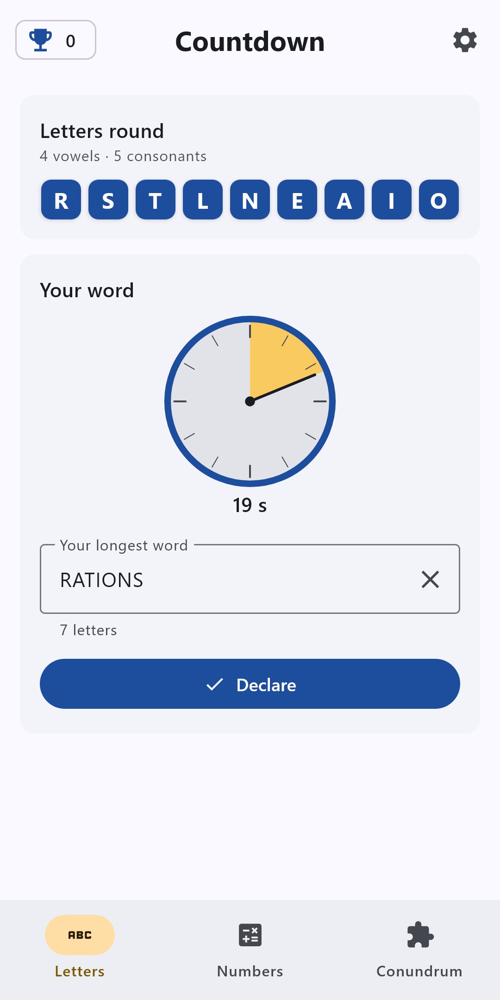
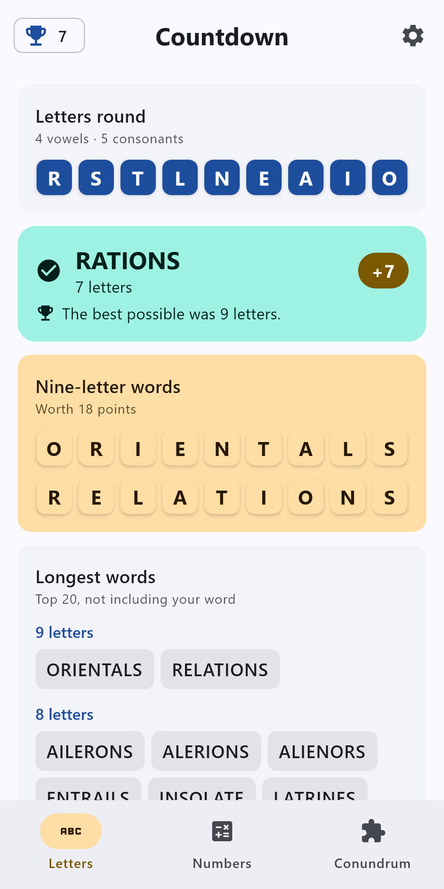
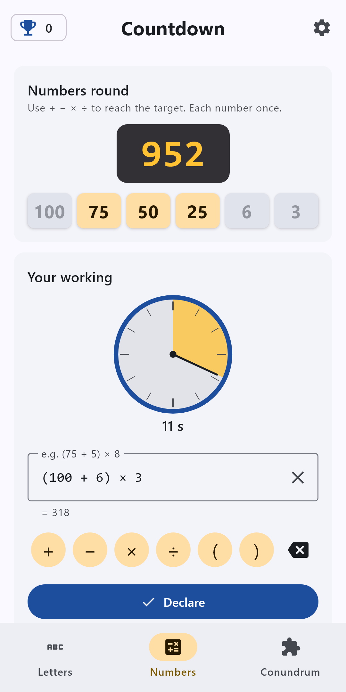
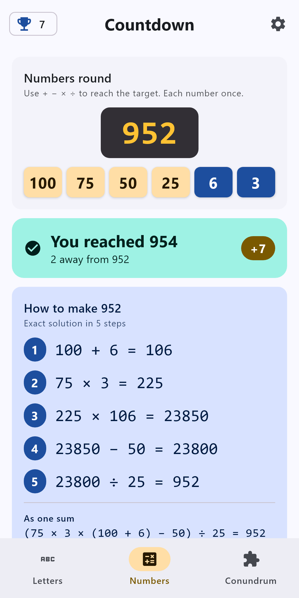
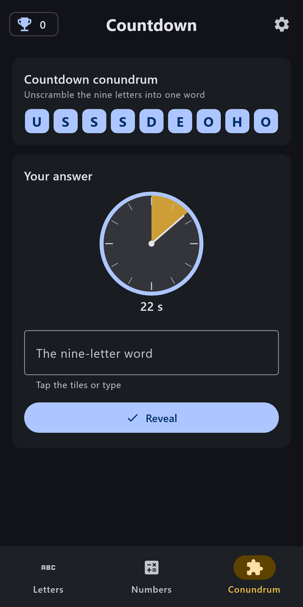

# Countdown – word & numbers game and solver

A Kotlin Multiplatform app for **Android and iOS**, built with Compose Multiplatform and Material 3. You can play the letters, numbers and conundrum rounds from Channel 4's *Countdown* against the 30-second clock. Afterwards it shows you the best answers and explains how to reach the target.

<p align="center">
  
  
  
</p>
<p align="center">
  
  
  
</p>

## Features

### Letters round
- Pick **Vowel** or **Consonant** one at a time. Letters are drawn from weighted piles, like on the show. You can also **type in** the nine letters from a real episode.
- The show's rule of **at least 3 vowels and 4 consonants** is enforced. You can switch this off in Settings.
- Find the longest word before the **30-second clock** runs out. Tap the tiles or type your word.
- The results show:
  - whether your word is valid,
  - your score (1 point per letter, **18 for a nine-letter word**),
  - every **nine-letter word** if one exists,
  - the **top 20 longest words**, not counting the one you entered.

### Numbers round
- Choose **0–4 large numbers** (25, 50, 75, 100). The rest are small numbers (two each of 1–10). You can also enter your own six numbers.
- The target is a **random number from 101 to 999**, or you can set your own.
- Build your working with the number tiles and the + − × ÷ ( ) keys. Each number can only be used once, and the app checks your working live.
- Scoring: **10 points** for exact, **7** if within 5, **5** if within 10.
- **Solve** tries every combination and shows the shortest exact method step by step, plus the same working as one sum. If no exact answer exists, it shows the closest one.

### Conundrum
- A nine-letter anagram with exactly one answer in the word list. Solve it within 30 seconds for 10 points.

### General
- A running score sits in the top bar. Settings has toggles for the clock and the vowel/consonant rule.
- Material 3 design with light and dark themes. The layout works on phones and tablets.

## Countdown rules used

| Round | Rule |
|---|---|
| Letters | 9 letters, chosen as vowels or consonants. At least 3 vowels and 4 consonants. 30 seconds. Proper nouns aren't allowed. |
| Letters scoring | 1 point per letter. A nine-letter word scores 18. |
| Numbers | 6 numbers: 0–4 from {25, 50, 75, 100}, the rest from two each of 1–10. Target 101–999. Only + − × ÷. Every result along the way must be a positive whole number. Each number used at most once. |
| Numbers scoring | Exact 10, within 5 → 7, within 10 → 5. |
| Conundrum | A nine-letter anagram. The first correct answer scores 10. |

On TV, words are checked against the Oxford dictionary, which can't be bundled with the app. This app uses the open-source [SCOWL](http://wordlist.aspell.net/) British English word list (size 70, both -ise and -ize spellings, about 79,000 words of 2–9 letters). Occasionally it will accept or reject a word differently from the show's adjudicator.

## Project layout

```
composeApp/src/
  commonMain/kotlin/.../game/   Rules, solvers, scoring (pure Kotlin, shared by every platform)
  commonMain/kotlin/.../ui/     Material 3 screens and components
  commonMain/composeResources/files/words.txt   Bundled word list
  androidMain/                  Android activity, manifest and icon
  iosMain/                      MainViewController used by the iOS app
  desktopMain/                  Desktop window (for development and screenshots)
  commonTest/  desktopTest/     Unit tests and the screenshot generator
iosApp/                         Xcode project (SwiftUI wrapper)
scripts/build_wordlist.py       Rebuilds words.txt from a SCOWL download
```

## Building

You need JDK 17 or newer. Android Studio is recommended, since it includes a JDK and the Android SDK.

Run the tests (they only need a JDK):

```powershell
./gradlew :composeApp:desktopTest
```

Build the Android app:

```powershell
./gradlew :composeApp:assembleDebug
```

Run the desktop version on your PC:

```powershell
./gradlew :composeApp:run
```

Regenerate the screenshots in `docs/screenshots`:

```powershell
./gradlew :composeApp:generateScreenshots
```

**iOS:** you need a Mac with Xcode. Open `iosApp/iosApp.xcodeproj` and run it. The build phase compiles the Kotlin framework automatically.

**CI:** GitHub Actions runs the tests, builds the debug APK (available as a downloadable artifact), runs the Kotlin tests on the iOS simulator, and builds the iOS app on macOS.

### Updating the word list

1. Download the list from <http://app.aspell.net/create?max_size=70&spelling=GBs&spelling=GBz&max_variant=0&diacritic=strip&download=wordlist&encoding=utf-8&format=inline>.
2. Rebuild `words.txt`:

```powershell
python -I scripts/build_wordlist.py path/to/scowl.txt
```

## Credits

- Word list: SCOWL/ESDB © Kevin Atkinson. See [third_party/SCOWL-LICENSE.txt](third_party/SCOWL-LICENSE.txt).
- *Countdown* is a Channel 4 programme. This is an unofficial fan-made practice tool and isn't affiliated with or endorsed by Channel 4.
