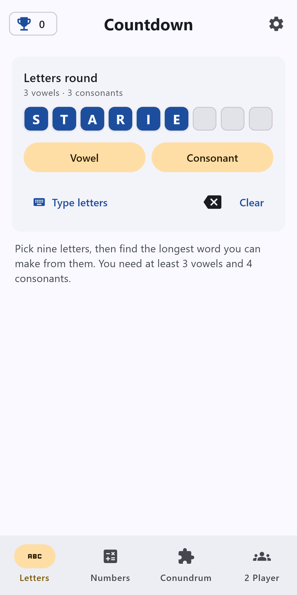
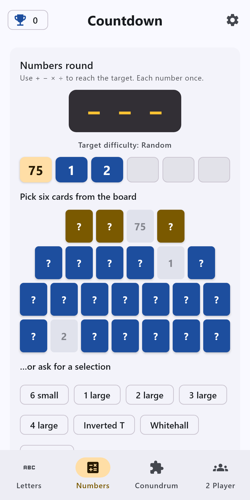
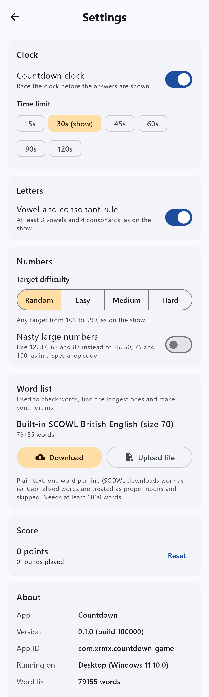

# Countdown – word & numbers game and solver

A Kotlin Multiplatform app for **Android and iOS**, built with Compose Multiplatform and Material 3. You can play the letters, numbers and conundrum rounds from Channel 4's *Countdown* against the clock. Afterwards it shows you the best answers and explains how to reach the target.

[](https://github.com/swooningfish/app-countdown-game/actions/workflows/android.yml)
[](https://github.com/swooningfish/app-countdown-game/actions/workflows/ios.yml)

**Latest Android build:** download `countdown-debug.apk` from the [`debug-latest` release](https://github.com/swooningfish/app-countdown-game/releases/tag/debug-latest). It is rebuilt on every push to `main`.

<p align="center">
  
  
  
</p>
<p align="center">
  
  
  
</p>
<p align="center">
  
  
</p>

## Features

### Letters round
- Pick **Vowel** or **Consonant** one at a time. Letters are drawn from weighted piles, like on the show. You can also **type in** the nine letters from a real episode.
- The show's rule of **at least 3 vowels and 4 consonants** is enforced. You can switch this off in Settings.
- Find the longest word before the **clock** runs out. Tap the tiles or type your word.
- The results show:
  - whether your word is valid,
  - your score (1 point per letter, **18 for a nine-letter word**),
  - every **nine-letter word** if one exists,
  - the **top 20 longest words**, not counting the one you entered.

### Numbers round
- **Turn over cards from the board**, laid out like the studio: four large numbers on the top row, and two each of 1–10 face down in rows of 6, 7 and 7.
- Or **ask for a selection used on the show**:

  | Selection | Large | Cards per row (top to bottom) |
  |---|---|---|
  | 6 small … 4 large | 0–4 | spread across the rows |
  | Inverted T | 1 | 1 · 1 · 1 · 3 |
  | Whitehall | 1 | 1 · 2 · 1 · 2 |
  | Motown | 4 | 4 · 0 · 1 · 1 |

- **Target difficulty** (in Settings) controls how the target is generated:

  | Difficulty | Target |
  |---|---|
  | Random | Any number from 101 to 999, as on the show |
  | Easy | Solvable in 1 or 2 operations |
  | Medium | Needs 3 or 4 operations |
  | Hard | Needs all 5 operations, or can't be solved exactly |

- **Nasty large numbers** (in Settings) swaps 25, 50, 75 and 100 for 12, 37, 62 and 87, as used in a special episode.
- You can also enter your own six numbers or set your own target.
- Build your working with the number tiles and the + − × ÷ ( ) keys. Each number can only be used once, and the app checks your working live.
- Scoring: **10 points** for exact, **7** if within 5, **5** if within 10.
- **Solve** tries every combination and shows the shortest exact method step by step, plus the same working as one sum. If no exact answer exists, it shows the closest one.

### Conundrum
- A nine-letter anagram with exactly one answer in the word list. Solve it before the clock runs out for 10 points.

### Settings
- **Clock:** on or off, with a time limit of 15, 30 (the show's, and the default), 45, 60, 90 or 120 seconds.
- **Letters:** the vowel/consonant rule.
- **Numbers:** target difficulty and nasty large numbers.
- **Word list:**
  - **Download** a new list from a link (the latest SCOWL British list is filled in for you).
  - **Upload** a text file from the device.
  - **Reset** to the built-in list at any time.
  - Imported lists are saved on the device.
- **Score:** your running total, and a button to reset it.
- **About:** app name, version and build, app ID, device/OS and word list size.

Settings and any imported word list are kept between launches.

## Countdown rules used

| Round | Rule |
|---|---|
| Letters | 9 letters, chosen as vowels or consonants. At least 3 vowels and 4 consonants. 30 seconds. Proper nouns aren't allowed. |
| Letters scoring | 1 point per letter. A nine-letter word scores 18. |
| Numbers | 6 cards from a board of 24: 4 large (25, 50, 75, 100) and two each of 1–10. Target 101–999. Only + − × ÷. Every result along the way must be a positive whole number. Each number used at most once. |
| Numbers scoring | Exact 10, within 5 → 7, within 10 → 5. |
| Conundrum | A nine-letter anagram. The first correct answer scores 10. |

On TV, words are checked against the Oxford dictionary, which can't be bundled with the app. This app uses the open-source [SCOWL](http://wordlist.aspell.net/) British English word list (size 70, both -ise and -ize spellings, about 79,000 words of 2–9 letters). Occasionally it will accept or reject a word differently from the show's adjudicator. You can swap in another list from Settings.

## App identifiers

| | |
|---|---|
| iOS bundle ID | `com.xrmx.countdown-game` |
| Android application ID / namespace | `com.xrmx.countdown_game` |
| Kotlin package | `com.xrmx.countdown_game` |

Android application IDs and Kotlin packages can't contain hyphens, so those use an underscore. The app name, version and IDs are set in [`gradle.properties`](gradle.properties).

## Project layout

```
composeApp/src/
  commonMain/kotlin/.../game/      Rules, solvers, scoring, word list parsing (pure Kotlin)
  commonMain/kotlin/.../ui/        Material 3 screens and components
  commonMain/kotlin/.../platform/  expect declarations: storage, download, file picker, back handling
  commonMain/composeResources/files/words.txt   Built-in word list
  androidMain/  iosMain/  desktopMain/          Platform implementations and entry points
  commonTest/  desktopTest/                     Unit tests and the screenshot generator
iosApp/                            Xcode project (SwiftUI wrapper)
scripts/build_wordlist.py          Rebuilds words.txt from a SCOWL download
```

## Building

You need JDK 17 or newer. Android Studio is recommended, since it includes a JDK and the Android SDK.

Run the tests (they only need a JDK):

```powershell
./gradlew :composeApp:desktopTest
```

Build the Android app:

```powershell
./gradlew :composeApp:assembleDebug
```

Run the desktop version on your PC:

```powershell
./gradlew :composeApp:run
```

Regenerate the screenshots in `docs/screenshots`:

```powershell
./gradlew :composeApp:generateScreenshots
```

**iOS:** you need a Mac with Xcode. Open `iosApp/iosApp.xcodeproj` and run it. The build phase compiles the Kotlin framework automatically.

## CI and releases

- **[Android CI](.github/workflows/android.yml)** runs on every push and pull request to `main`, and on `v*` tags. It:
  - works out the version from git tags,
  - runs the unit tests and Android lint,
  - builds the debug APK and uploads it as an artifact.
- **Pushes to `main`** also update the rolling **`debug-latest`** pre-release with `countdown-debug.apk`.
- **A `v1.2.3` tag** publishes a versioned release with the APK attached.
- **Version scheme:** tag `vX.Y.Z` gives versionName `X.Y.Z` and versionCode `(X·10000 + Y·100 + Z)·1000`. Builds from `main` are `<last tag>-main.<run>`, with a versionCode just above that tag. Each new APK therefore installs over the last one. Without any tags the base version is `0.1.0`.
- **[iOS CI](.github/workflows/ios.yml)** runs the Kotlin tests on the iOS simulator and builds the app for the simulator on macOS.

### Signing key for CI

Each CI runner creates a fresh debug keystore. Without a fixed key, a new APK won't install over the previous one (Android reports a signature mismatch). To sign every CI build with the same key, do this once:

```powershell
keytool -genkeypair -v -keystore countdown-ci.jks -storetype PKCS12 -alias countdown -keyalg RSA -keysize 4096 -validity 10000 -dname "CN=Countdown"
```

```powershell
[Convert]::ToBase64String([IO.File]::ReadAllBytes("countdown-ci.jks")) | Set-Content countdown-ci.jks.b64
```

Then add these repository secrets (Settings → Secrets and variables → Actions):

| Secret | Value |
| --- | --- |
| `COUNTDOWN_KEYSTORE_BASE64` | contents of `countdown-ci.jks.b64` |
| `COUNTDOWN_KEYSTORE_PASSWORD` | the keystore password |
| `COUNTDOWN_KEY_ALIAS` | `countdown` |
| `COUNTDOWN_KEY_PASSWORD` | the key password (with PKCS12, the same as the keystore password) |

Then:
- Keep `countdown-ci.jks` and its passwords safe outside the repo. `*.jks` is gitignored.
- Delete `countdown-ci.jks.b64`.
- Uninstall the old app once, because the first APK signed with the new key won't install over an earlier CI build.
- To build an APK locally that updates the CI one, set the same four `COUNTDOWN_*` variables, with `COUNTDOWN_KEYSTORE_PATH` pointing at the `.jks` file.

### Updating the built-in word list

1. Download the list from <https://app.aspell.net/create?max_size=70&spelling=GBs&spelling=GBz&max_variant=0&diacritic=strip&download=wordlist&encoding=utf-8&format=inline>.
2. Rebuild `words.txt`:

```powershell
python -I scripts/build_wordlist.py path/to/scowl.txt
```

## Roadmap

### Two-player game
Play a full game against a friend, with scores kept for each player.

- **Suggested running order:** the app proposes a default set of rounds, like a full show: letters and numbers rounds (10 letters and 4 numbers in the full format), finishing with a conundrum. You can change the order or the number of rounds before starting.
- **Letters and numbers rounds:** players take turns choosing the vowels/consonants and the large/small numbers, as contestants do on the show. Both play the same selection against the same clock. The results show both answers side by side and award points as on the show (if both have equal words, both score).
- **Conundrum at the end:** the app suggests one from the word list, or you can type in a known conundrum (for example, one from a real episode). The first player to buzz in with the right answer scores 10.
- **Dual mode over Bluetooth:** each player uses their own phone. One device hosts the game and the other joins over Bluetooth. Letters, numbers, the clock, answers and scores stay in sync on both. Bluetooth Low Energy will be used so an Android phone and an iPhone can play each other.

## Credits

- Word list: SCOWL/ESDB © Kevin Atkinson. See [third_party/SCOWL-LICENSE.txt](third_party/SCOWL-LICENSE.txt).
- *Countdown* is a Channel 4 programme. This is an unofficial fan-made practice tool and isn't affiliated with or endorsed by Channel 4.
